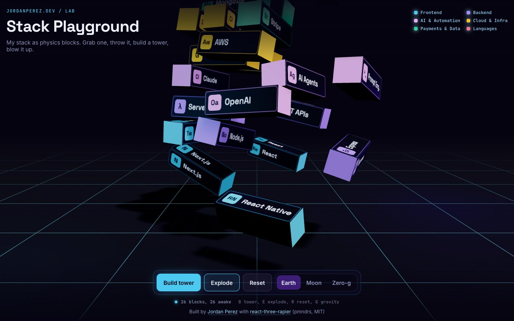

# Stack Playground

My tech stack as a physics toy. Every skill from [jordanperez.dev](https://jordanperez.dev) is a brick you can grab, throw, stack into a tower and blow up.

**Live:** https://jewgah.github.io/stack-playground/



## What you can do

- **Grab and throw** any block with the mouse or a finger. The block is pulled toward the pointer by a velocity spring, and keeps its speed when you let go, so a flick throws it.
- **Build tower** stacks all 26 blocks into an interlocking Jenga style tower.
- **Explode** applies a radial impulse (plus a little spin) from just below the pile.
- **Reset** drops the blocks back onto the floor.
- **Gravity**: Earth (9.81), Moon (1.62) or Zero-g. The arena has invisible walls and a ceiling, so floating blocks stay in view.
- Keyboard: `B` tower, `E` explode, `R` reset, `G` cycle gravity.

Blocks are colored by category (Frontend, Backend, AI & Automation, Cloud & Infra, Payments & Data, Languages). The glyphs are original two letter monograms drawn on a canvas, not vendor logos.

## Performance notes

- The canvas renders on demand (`frameloop="demand"`) and physics runs in its own loop (`updateLoop="independent"`), so once every body is asleep nothing is drawn. The status line shows how many blocks are awake.
- Device pixel ratio is capped at 1.75.
- Pointer tracking uses window level listeners with `touch-action: none` on the canvas, so touch drags work on mobile without scrolling the page.

## Stack

- [React 19](https://react.dev) + TypeScript, built with [Vite](https://vite.dev)
- [@react-three/fiber](https://github.com/pmndrs/react-three-fiber) 9 and [@react-three/drei](https://github.com/pmndrs/drei) 10 (grid)
- [@react-three/rapier](https://github.com/pmndrs/react-three-rapier) for the physics (Rapier compiled to WebAssembly)
- Fonts: Space Grotesk, Inter and JetBrains Mono via [Fontsource](https://fontsource.org)

## Run it

```bash
npm install
npm run dev      # http://localhost:5173/stack-playground/
npm run build    # type check + production build into dist/
npm run preview
```

Pushing to `main` deploys to GitHub Pages through `.github/workflows/deploy.yml`.

## Credits

- Physics bindings: [react-three-rapier](https://github.com/pmndrs/react-three-rapier) by Poimandres (pmndrs), MIT licence. This project uses it as an npm dependency, it is not a fork.
- Physics engine: [Rapier](https://rapier.rs) by Dimforge, Apache 2.0.
- Concept, code and design: [Jordan Perez](https://jordanperez.dev).

## Licence

MIT
